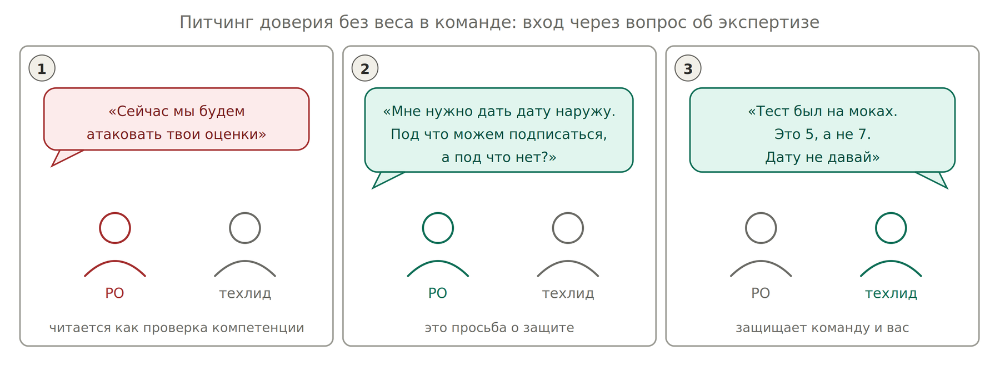
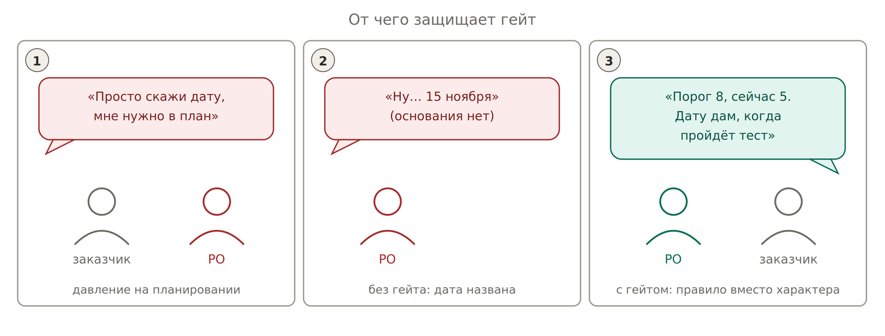

# Шаг 4. Разговор с командой про даты

*Тот же механизм. Разный вход*

*От чего защищает правило порога: от даты, названной под давлением*

Ритуал не требует мандата. Требует правильной рамки: вы просите защитить вас от обещания, которое команде потом исполнять. Опытный инженер эту рамку узнаёт сразу.

«Назначить CP» — зафиксировать число по сильнейшему выжившему доказательству. Не голосованием, не средним мнением. Если техлид молча соглашается — механизм мёртв.

## Как это проходит технически

Десять минут рядом с демо, не отдельная встреча. Ноут не открываете, файл со ставками не показываете, терминов не произносите. Список держите в голове или в блокноте, а записываете после разговора.

| **Что спрашиваете** | **Что вы этим измеряете** |
| --- | --- |
| «Что мы уже видели своими глазами, а что пока на словах?» | Отделяет обещания (2–3) от проверенного (5 и выше) |
| «Мы это гоняли на заглушках или против их реальной системы?» | Разделяет ступень 5 и 6 — самая частая переоценка |
| «Если я назову 15 ноября и что-то поедет — где вероятнее всего поедет?» | Вытаскивает слабое звено, о котором вы не знали |
| «Готов, чтобы я на QBR сказал: интеграция готова?» | Главный вопрос: переводит уверенность в личную ответственность |

Последний вопрос — рабочая лошадка. Техлид отвечает честно, потому что отвечать придётся ему.

## Пример диалога

> — Ребят, под что мы можем подписаться по интеграции?
>
> — Ну, API мы дёрнули, вроде работает.
>
> — На заглушках или против их стенда?
>
> — На их стенде, но одним запросом, руками.
>
> — Понял. Если я скажу на QBR «интеграция готова» — ты подпишешься?
>
> — Не, погоди. Сквозной сценарий не гоняли, там оплата и возврат.
>
> — Отлично, это и хотел услышать. Тогда наружу даты не даю. Что нужно в следующий спринт, чтобы ты был спокоен?
>
> — Сквозной тест на стейдже, полдня работы.
>
> — Ставим в спринт.

После этого разговора вы у себя ставите 6 вместо 7 и переносите дату. Техлид не услышал ни одного термина и при этом сделал всю работу по оценке.
