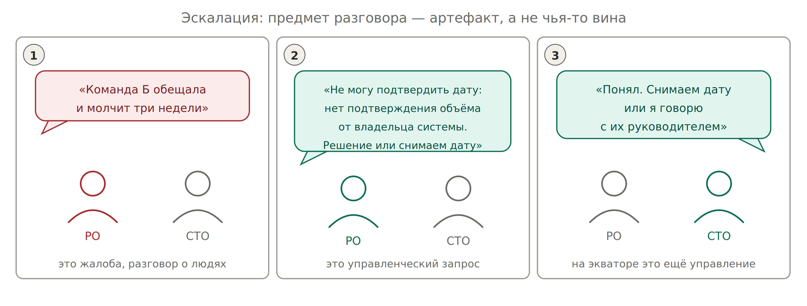

# Шаг 6. Внешние зависимости и эскалация

| **Правило** | **Механика** |
| --- | --- |
| Объект управления — ваш | Целиться в CP по своим узлам, не в чужую фичу |
| Нет письма — нет ступени выше 3 | Устное обещание смежника не поднимает CP, как бы уверенно ни звучало |
| Редкость наблюдения — потолок | Видите команду раз в спринт — потолок около 5 |

## Как получить артефакт, не начиная войну

Смежный директор с пятью проектами может отказаться писать письмо: «на синхе всё обсудили, я устал от бюрократии». Дожимать не нужно. Три хода по порядку.

| **Ход** | **Что делаете** | **Что получаете** |
| --- | --- | --- |
| 1. Не бумага, а техническая реальность | Ступени выше 5 подписи смежника не требуют. Тест против его реального API вы делаете сами | Ступень 6 без его участия. Бумага нужна только там, где проверить руками нельзя: сроки, люди, юридика |
| 2. Его собственный канал | Он сказал «пиши в Jira-эпик» — значит канал легитимирован им. Пишете комментарий: «фиксирую договорённость: API к 15.10» | Работает не его ответ, а история изменений: если дата поедет, в Jira останется след, и это уже артефакт |
| 3. Письмо, на которое дешевле ответить, чем промолчать | Резюме пишете вы, но дефолт ставите неудобный: «фиксирую 15.10; если не успеваете — скажите, поставлю 30.10 и пересогласую план витрины» | Одно слово «ок» — его письменное подтверждение, ступень 3. Ответ «нет, 30.10» — артефакт ещё более ценный |

**Правило, которое нельзя нарушать:** молчание не является подтверждением. «Не ответил — значит согласен» прямо нарушает правило полномочий и обнуляет всю механику.

| **Артефакты, не требующие усилий смежника** | **Ступень** |
| --- | --- |
| Протокол встречи от PMO или секретаря | 3 |
| Релизноут его команды, их квартальный план в Confluence, их роадмап | 3–4 |
| История переносов даты в его тикете | сигнал деградации, не ступень |
| Ваш собственный тест против его системы | 6 |

**Главное для тех, кто начинает:** CP 3 — не проблема, которую надо починить. Это факт, который меняет ваше обещание, а не ваши отношения. Вы не воюете за ступень — вы просто не даёте дату. Разница принципиальная: в первом случае вы конфликтуете с человеком, во втором управляете своим риском.

*Одна и та же ситуация. Разный предмет разговора*

Журнал чужих обещаний без применения — прикрытие спины. Применений два, оба смотрят вперёд: не дать обещание сейчас, и калибровка на следующий квартал.

| **Уровень** | **Решает** | **Триггер выше** |
| --- | --- | --- |
| Команда и техлид | Насыщение в своей зоне | CP не дотягивает к дате гейта |
| PO | Ресурс между потоками | Нужны полномочия вне зоны |
| CTO / CPO / CEO | Бюджет, найм, приоритет | — |

**Тайминг:** на экваторе эскалация — управление. Через месяц та же эскалация — оправдание.
