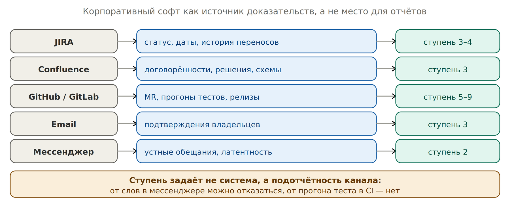

# Шаг 7. Подключить корпоративный софт


*Каждая система даёт свой класс доказательств*

## Что значит «ступень»

Ступень — это уровень подтверждённости: насколько сильное доказательство даёт этот источник. Шкала от 2 (кто-то сказал) до 9 (работает в проде). Полностью она описана в [разделе 9](../theory/confidence-points.md) и в [приложении «Лестница доказательств»](../appendix/ladder.md); здесь последняя колонка таблицы показывает, на какую ступень обычно тянет информация из каждой системы.

| **Ступень** | **Что за ней стоит** |
| --- | --- |
| 2 | Устное: созвон, личные сообщения. От такого можно отказаться |
| 3–4 | Письменное или показанное: письмо, тикет с датой, демо |
| 5–6 | Проверенное: прогон на моках, тест против реальной системы |
| 7–9 | Работающее: ограниченный объём, пилот, полный прод |

| **Система** | **Что берём** | **Чего не берём** | **Ступень** |
| --- | --- | --- | --- |
| JIRA | Даты, история переносов, кто владелец. Перенос — сигнал деградации | Статус как доказательство: «In Progress» ничего не доказывает | 3–4 |
| Confluence | Решения, схемы интеграций, договорённости со ссылкой и датой | Страницы без даты правки — их свежесть неизвестна | 3 |
| GitHub / GitLab | MR, прогоны тестов, релизы, время до ревью | Ничего. Это сильнейший источник | 5–9 |
| Email | Подтверждения владельцев: что, объём, дата | Обсуждения без вывода | 3 |
| Мессенджер | Устные обещания (ступень 2), латентность, тишина | Факты о мире от третьих лиц — это слухи | 2 |

## Как это подключать

| **Уровень** | **Режим работы с софтом** |
| --- | --- |
| 0–1 | Ручной триггер через `inbox.md`. Агент не читает ваш Slack и Outlook |
| 2 | MCP-коннекторы на чтение: JIRA и GitHub. Агент сам смотрит переносы и MR |
| 3 | Автоприём почты и чатов. Отбраковка 95%. Считаются латентность и тишина |

## Уровень 0: как передать агенту сообщение из Slack или почты

Claude Code не имеет доступа к корпоративному мессенджеру и почте. Значит на уровне 0 вставка текста — единственный путь, и это не противоречие. Запрет касается копирования потока, а не цитаты.

| **Так нельзя** | **Так нужно** |
| --- | --- |
| Скинуть дайджест переписки за день, 40 сообщений, «разбери» | Одна цитата: дата, кто, канал, permalink, две строки текста |

Механика: файл `inbox.md` в репозитории. В течение дня вставляете туда по три строки. Раз в два-три дня — `/paf-evidence`, агент разносит записи в evidence и узлы и очищает inbox.

```text
# inbox.md

2026-09-17 | Петров, владелец системы «Расчёты» | slack: <permalink>
"объём подтвердим к концу недели, схему отдадим после"
```

**Зачем permalink, если агент не может его открыть:** ссылка нужна не агенту, а человеку. У агента есть ваша цитата. Ссылка лежит в evidence, чтобы вы или техлид проверили источник через полгода. Провенанс требует локализуемой ссылки, а не машиночитаемой.

## Jira остаётся обязательным фасадом. Как не делать двойную работу

| **Развязка** | **Механика** |
| --- | --- |
| Статусы тикетов — не ваша работа | Их двигает команда. Вручную вы собирали не статусы, а нарратив для PMO — вот он и уходит агенту |
| Нет отображения 1:1 | Ставок на квартал 3–7, тикетов сотни. В файле ставки одно поле jira: [KEY-1, KEY-2], заполняется один раз |
| Направление строго одно: git → Jira | Отчёт для PMO генерируется из ставок, вы вставляете его в Confluence или комментарий к эпику. Обратно никогда: статус в Jira в CP не попадает |
| Что из Jira ценно как доказательство | Не статус, а история изменения даты и смены исполнителя. Третий перенос срока — сигнал деградации, его заводят в evidence |
