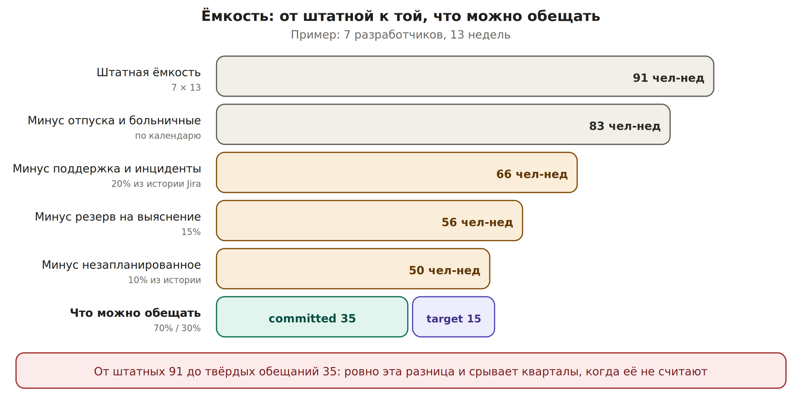

# П3-квинт. Кейс: что вмещается в квартал

Бизнес приносит больше инициатив, чем команда может сделать. Требования подготовлены. Нужно решить, что берём, что нет, и объяснить это так, чтобы решение не превратилось в торг.

## Почему в классике это решается плохо

Классическая схема: оценить требования в человеко-днях, сложить, сравнить со штатной ёмкостью, отсортировать по громкости заказчиков, остальное — в беклог. У неё три дефекта, и каждый системный.

| **Дефект** | **Что происходит** |
| --- | --- |
| Сравнение со штатной ёмкостью | Поддержка, инциденты, отпуска и незапланированное съедают треть и больше. План на 100% штатной ёмкости сорван в момент подписания |
| Все оценки считаются одинаково надёжными | Оценка по понятной фиче и по интеграции с чужой системой складываются как равные. Вторая уедет вдвое |
| Приоритет задаётся голосом | Выигрывает заказчик, который громче или выше. Не взятое уходит в беклог молча, и заказчик узнаёт об этом в конце квартала |

## Шаг 1. Посчитать реальную ёмкость


*Разница между штатной ёмкостью и твёрдыми обещаниями*

Доли поддержки и незапланированного не придумываются, а берутся из истории: сколько задач типа «инцидент», «баг с прода», «срочный запрос» закрыла команда за прошлый квартал. Агент считает это по выгрузке из Jira за несколько минут.

**Правило:** твёрдые обязательства занимают не больше 70% от посчитанной ёмкости. Остальное — target с гейтом. План, в котором committed равен всей ёмкости, не оставляет места ни для одной неожиданности, а неожиданности в квартале бывают всегда.

## Шаг 2. Фильтр на входе: связь с целью

Каждая инициатива проверяется одним вопросом: условием достижимости какой цели квартала она является? Если ответа нет — инициатива не рассматривается в этом квартале. Не отклоняется, а откладывается с явной причиной.

Этот шаг обычно отсекает от трети до половины запросов. Не потому что они плохие, а потому что они не про эту цель.

## Шаг 3. Оценка с учётом неопределённости

К каждой оценке добавляется вопрос: насколько мы в ней уверены? Он решается той же лестницей, что и уверенность в обещаниях.

| **Уверенность в оценке** | **Признак** | **Что делаем с оценкой** |
| --- | --- | --- |
| Высокая | Похожее делали, всё внутри команды | Берём как есть |
| Средняя | Новое, но без внешних зависимостей | Умножаем на 1,3 |
| Низкая | Зависит от чужой системы или чужой команды | Умножаем на 1,5–2 либо сначала выясняем, потом оцениваем |
| Неизвестная | Требования есть, но никто не делал ничего подобного | Не оцениваем. Первый шаг — задача на выяснение в первый спринт |

**Почему множитель, а не точная оценка:** точно оценить неизвестное нельзя. Множитель честно показывает, что именно здесь вероятнее всего уедет срок, и заранее резервирует под это ёмкость. Коэффициенты уточняются на калибровке после первого квартала.

## Шаг 4. Сортировка не по голосу, а по отдаче

Для каждой прошедшей фильтр инициативы — три числа: ценность, уверенность в ней, скорректированная стоимость. Сортировка по ценности на единицу ёмкости с поправкой на уверенность.

| **Инициатива** | **Ценность** | **Уверенность в ценности** | **Стоимость, чел-нед** | **Решение** |
| --- | --- | --- | --- | --- |
| Расчёты с внешним организатором | высокая, письмо директора | подтверждена | 12 × 1,5 = 18 | committed |
| Новый отчёт для партнёров | средняя | устная | 6 | committed |
| Интеграция с новым платёжным шлюзом | высокая | подтверждена | неизвестна | target: выяснение в спринте 1, решение к 20.10 |
| Переработка админки | низкая | мнение | 15 | не берём, причина и условие — письмом |
| Выгрузка для аналитики | не связана с целью квартала | — | — | не рассматривается в этом квартале |

Ценность берётся у владельца направления с автором и датой — по тем же правилам провенанса, что в кейсе с обоснованием инициативы. Вы не оцениваете чужую выручку сами.

## Шаг 5. Что не влезло: письмом, а не молчанием

Всё, что не взято, отправляется заказчику явно, в тот же день, одним письмом:

```text
Не берём в этом квартале: переработка админки
Причина: при текущей ёмкости это вытесняет расчёты с организатором,
         ценность которых подтверждена письменно
Условие: возвращаемся к вопросу на середине квартала, если
         интеграция с платёжным шлюзом окажется проще оценки
         либо если ценность админки будет подтверждена цифрой
```

Третья строка — главная. Условие превращает отказ в очередь с понятным входом. Заказчик получает не «нет», а «вот что должно произойти, чтобы да».

## Шаг 6. Точка пересмотра на экваторе

В середине квартала часть target превращается в committed, часть неизвестных оценок становится известной, и освобождается ёмкость. Тогда из списка не взятого поднимается то, чьё условие выполнилось. Решение принимается один раз на экваторе, а не каждую неделю по новому запросу.

## Если потоков несколько

Сначала распределяется ёмкость между потоками, потом внутри потока. Иначе самый громкий поток съедает ёмкость остальных. Распределение между потоками — решение уровня руководителя с вашими расчётами; распределение внутри потока — решение того, кто поток ведёт.

## Что делает агент

| **Агент** | **Вы** |
| --- | --- |
| Считает долю поддержки и незапланированного из истории задач | Проверяете, что история репрезентативна |
| Сводит инициативы в одну таблицу с оценками и связью с целью | Решаете, какие связаны с целью |
| Применяет множители по уровню уверенности | Подтверждаете уровень уверенности по каждой |
| Строит два-три сценария наполнения квартала | Выбираете сценарий |
| Готовит письма по не взятому с причиной и условием | Отправляете и отвечаете на возражения |

## Три режима: как было, переходный период, вся команда

| **Шаг** | **Как было** | **Переходный период: лично вы** | **Вся команда на PAF** |
| --- | --- | --- | --- |
| Ёмкость | Штатная, иногда минус отпуска | Реальная: вы считаете долю поддержки из истории и закладываете резервы | Считается автоматически по всем командам, одна методика на департамент |
| Вход инициатив | Всё, что принесли | Фильтр связи с целью применяете вы при разборе | Инициатива без связи с целью не может быть подана — это поле обязательное |
| Оценка | Одна цифра, все равны | Цифра плюс ваша поправка на уверенность | Цифра, уверенность и история точности оценок этой команды |
| Приоритет | Громкость заказчика | Ценность на единицу ёмкости, ценность — с источником | То же, но видно всем заказчикам одновременно |
| Что не влезло | Молча в беклог | Письмом с причиной и условием | Общая очередь с условиями входа, видимая всем |
| Середина квартала | Выясняется, что план не держится | Пересмотр на экваторе по арифметике | Пересмотр по событию гейта, без отдельной встречи |
| Разговор с бизнесом | Торг: каждый доказывает важность своего | Разговор о цифрах вместо торга | Торга нет: правила выбора известны заранее |

**Что меняется по существу:** в классике решение о наполнении квартала — это итог переговоров, и его качество зависит от переговорной силы. В переходном периоде оно становится расчётом, который вы можете предъявить. В полной модели оно становится правилом, которое не нужно защищать каждый раз.
