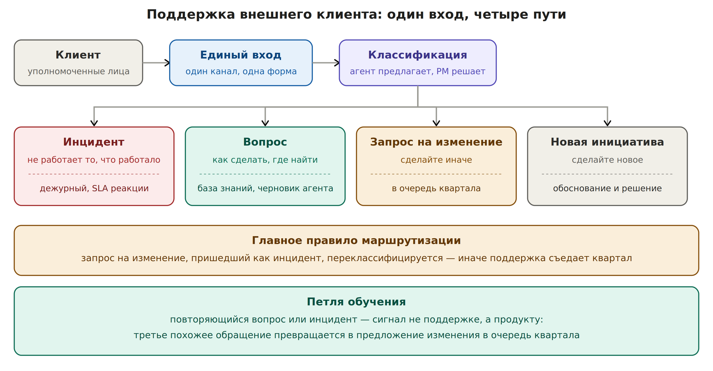

# П3-секст. Кейс: поддержка внешнего клиента

Команда взяла клиента на поддержку. Запросы приходят в чаты, в почту, лично инженерам. Всё помечено как срочное. Через месяц поддержка съедает квартал, а знание о клиенте живёт в головах двух-трёх человек.

## Почему это разваливается в классике

| **Дефект** | **Что происходит** |
| --- | --- |
| Много входов | Клиент пишет тому, кто быстрее ответил в прошлый раз. Запросы теряются, дублируются, решаются без ведома PO |
| Нет типов запросов | Инцидент, вопрос и просьба «сделайте иначе» идут одной очередью с одинаковой срочностью |
| Изменения маскируются под инциденты | Клиент быстро учится: срочное делается сразу. Доработки начинают приходить как «у нас всё сломалось» |
| Ёмкость не ограничена | Поддержка берёт столько, сколько попросят. Квартальные обещания срываются незаметно |
| Не определены полномочия | Приоритет меняет любой сотрудник клиента, и команда исполняет противоречащие друг другу просьбы |
| Знание в головах | История клиента, его процессы и договорённости известны тем, кто с ним работал. Уход человека обнуляет контекст |

## Решение: клиент — это отдельный узел знания

Первый системный шаг — завести клиента как отдельный объект со своим узлом. Туда попадает всё, что сейчас разбросано по людям.

| **Раздел узла клиента** | **Что внутри** | **Кто заполняет** |
| --- | --- | --- |
| Договор и SLA | Что входит в поддержку, что нет, сроки реакции и решения по типам запросов | Вы, один раз, из договора |
| Полномочия | Кто со стороны клиента может ставить приоритет, кто может согласовывать изменения, кто только сообщает | Вы, со стороны клиента подтверждает его руководитель |
| Поддерживаемые процессы | Какие бизнес-процессы клиента зависят от вашей системы и что для них критично | Агент из обращений, вы проверяете |
| История обращений | Что просили, что сделано, что отклонено и почему | Агент |
| Открытые обязательства | Что и к какой дате обещано клиенту, на каком основании | Вы, через гейт |

**Раздел про полномочия — самый важный:** без него приоритеты клиента противоречат друг другу, и команда исполняет того, кто громче. Одна строка «приоритет меняет только такой-то» снимает половину конфликтов, и её лучше согласовать письменно в первую неделю.

## Бизнес-процесс: один вход, четыре пути

*Маршрутизация запросов внешнего клиента*

| **Тип** | **Признак** | **Путь** | **Обещание клиенту** |
| --- | --- | --- | --- |
| Инцидент | Перестало работать то, что работало | Дежурный инженер, эскалация по SLA | Срок реакции — всегда. Срок решения — только когда понятна причина |
| Вопрос | Как сделать, где найти, почему так | База знаний; агент готовит черновик, отвечает человек | Срок ответа по SLA |
| Запрос на изменение | Работает, но нужно иначе | В очередь квартала, через фильтр ёмкости из [П3-квинт](p3-kvint-capacity.md) | Дата рассмотрения, а не дата выполнения |
| Новая инициатива | Нужно то, чего нет | Обоснование и решение по правилам [П3-тер](p3-ter-tech-initiative.md) | Дата решения |

**Главное правило маршрутизации:** запрос на изменение, пришедший как инцидент, переклассифицируется открыто и сразу, с объяснением клиенту. Это единственное, что не даёт поддержке съесть квартал. Первые два-три раза будет неловко; на четвёртый клиент начнёт классифицировать сам.

## Как вводить единый вход, не ломая отношения

Нельзя в один день запретить клиенту писать инженерам. Можно сделать единый вход выгоднее остальных.

| **Шаг** | **Что делаете** |
| --- | --- |
| Неделя 1 | Согласовываете с руководителем клиента полномочия и единый канал. Объяснение: так ни один запрос не потеряется и у каждого будет срок |
| Недели 2–3 | Инженеры отвечают на личные сообщения клиента одной фразой: «переношу в общий канал, там будет срок и отслеживание». И переносят сами |
| Неделя 4 | Запросы через общий канал получают срок, личные — нет. Клиент сам переходит туда, где предсказуемее |

## Ёмкость на клиента

Поддержка клиента получает фиксированную долю ёмкости команды — так же, как поддержка системы в [П3-квинт](p3-kvint-capacity.md). Размер доли определяется из договора и истории обращений за первые недели.

| **Ситуация** | **Решение** |
| --- | --- |
| Запросы укладываются в долю | Работа идёт без вашего участия, только красные строки в скане |
| Запросы превышают долю | Не добирается молча из квартальной ёмкости. Решение руководителя: расширить долю за счёт чего-то конкретного или ограничить поддержку |
| Доля стабильно превышается | Сигнал к пересмотру договора или к продуктовому изменению, которое снимет поток обращений |

## Ритм работы с клиентом

| **Каденция** | **Что происходит** | **Что снимаем** |
| --- | --- | --- |
| Ежедневно | Агент разбирает входящие, предлагает тип и ищет похожие прошлые обращения. PM подтверждает тип | Новые обращения, нарушения SLA |
| Раз в две недели | Синк с уполномоченным лицом клиента, 30 минут | Изменения в их процессах и приоритетах; статус открытых обязательств |
| Раз в месяц | Отчёт клиенту: сколько обращений каждого типа, SLA, что сделано, что в очереди и почему | Подтверждение, что очередь соответствует их приоритетам |
| Раз в квартал | Разбор повторяющихся обращений: что превратить в изменение продукта | Предложения в очередь квартала |

## Петля обучения

Повторяющееся обращение — сигнал не поддержке, а продукту. Третье похожее обращение автоматически становится предложением изменения в очередь квартала. Это единственный способ, при котором нагрузка на поддержку со временем снижается, а не растёт.

## Роли

| **Кто** | **Что делает** |
| --- | --- |
| PO | Держит договор, полномочия и гейт на обещания клиенту. Решает по запросам на изменение и инициативам |
| PM потока | Подтверждает классификацию, ведёт синк и ежемесячный отчёт, следит за долей ёмкости |
| Дежурный инженер | Реагирует на инциденты по SLA |
| Стажёр-хранитель | Ведёт историю обращений и готовит материал к отчёту |
| Агент | Классифицирует, ищет похожее, готовит черновики ответов, считает долю ёмкости и повторяемость |

**Чего агент не делает:** не отвечает клиенту сам и не обещает сроки. Черновик ответа — да, отправка — человек. Обещание срока клиенту проходит через гейт, как любое обещание наружу.

## Метрики

| **Метрика** | **Что показывает** |
| --- | --- |
| Доля ёмкости, ушедшая на клиента, против заложенной | Держится ли граница поддержки |
| Соблюдение SLA по реакции | Работает ли единый вход и дежурство |
| Доля переклассифицированных обращений | Насколько клиент маскирует изменения под инциденты; должна падать |
| Доля повторяющихся обращений | Работает ли петля обучения; должна падать от квартала к кварталу |

## Три режима

| **Аспект** | **Как было** | **Переходный период: лично вы** | **Вся команда на PAF** |
| --- | --- | --- | --- |
| Вход | Кто куда написал | Единый канал, который вы ввели для своего клиента | Единый вход для всех клиентов департамента |
| Классификация | Нет, всё срочное | Четыре типа, агент предлагает, PM решает | Типы и маршруты одинаковы для всех клиентов |
| Знание о клиенте | В головах инженеров | Узел клиента в вашем репозитории | Общий узел, доступный всем, кто с клиентом работает |
| Ёмкость | Без ограничений, за счёт квартала | Фиксированная доля, превышение — решение руководителя | Доли видны на уровне портфеля вместе с остальными обещаниями |
| Обещания клиенту | Даёт тот, кого спросили | Только через ваш гейт | Через гейт, по единым правилам |
| Повторяющиеся обращения | Решаются каждый раз заново | Третье похожее идёт в очередь квартала | Становятся источником продуктовых изменений для всего департамента |
