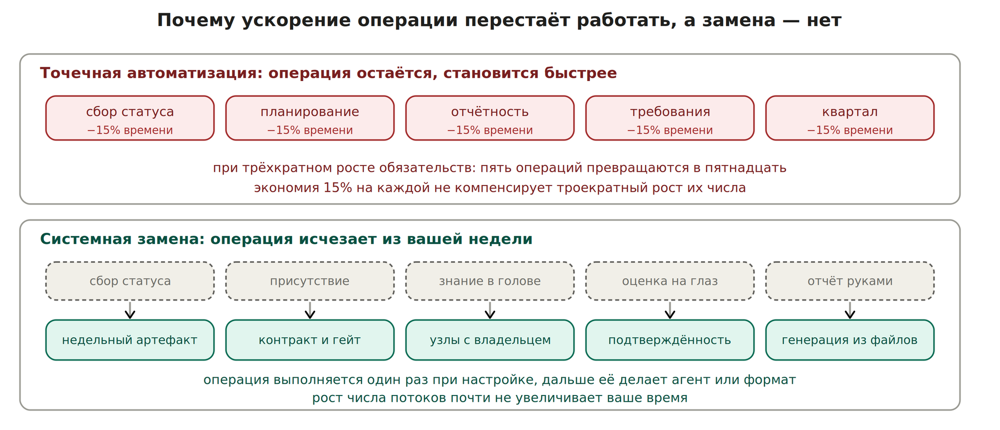

# П1. Точка входа: что сломалось и чем это заменить

Типичная стартовая позиция: ИИ уже применяется точечно — сбор статусов с техлидов, планирование спринта, отчётность, работа с требованиями, планирование квартала. Это даёт 10–15% на отдельных операциях и ощущение преимущества перед коллегами.

Преимущество исчезает при росте обязательств, и вот почему: точечная автоматизация ускоряет операцию, но не уменьшает их количество. Когда обязательств становится втрое больше, вы просто быстрее делаете втрое больше работы.

| **Что работало** | **Что сломалось при трёхкратном росте** |
| --- | --- |
| ИИ ускоряет сбор статуса | Статусов стало четыре вместо одного — ускорение съедено |
| Прямой доступ к дейликам команды | Четыре дейлика физически не помещаются в неделю |
| Вы — источник знания о потоке | Пять потоков в одной голове не держатся |
| Контроль через присутствие | При 35 людях присутствие невозможно в принципе |

**Суть перехода:** меняется не скорость, а роль. Вы перестаёте быть производителем статуса и становитесь потребителем артефактов. Всё остальное в этой части — следствие этого одного решения.

*Ускорение операции против её устранения*

## Решение: пять системных замен

Каждый элемент, который сломался, чинится не ускорением, а заменой: операция уходит из вашей недели целиком. Ниже — что именно меняется в процессе.

| **Что сломалось** | **Что меняете в процессе** | **Кто должен согласиться** |
| --- | --- | --- |
| Сбор статуса разговором: при четырёх командах это часы в неделю | Техлид раз в неделю даёт пять строк в фиксированном формате в своём же канале. Вы читаете, а не спрашиваете ([П4](p4-artifact-not-presence.md)) | Только сами техлиды, по одному разговору с каждым |
| Присутствие на дейликах: физически не помещается | Контракт делегирования: поток ведёт техлид или PM, у вас остаётся только гейт на обещания наружу ([П2](p2-configuration.md), [П5](p5-delegation.md)) | Техлид или PM. Руководство не участвует |
| Знание о потоках в вашей голове: пять потоков не держатся | Узлы знания с владельцем и датой проверки. Знание переживает ваш отпуск и смену людей ([раздел 7](../theory/nexuses.md)) | Никто. Это ваши файлы |
| Оценка сроков на глаз: при новых потоках истории оценок нет | Подтверждённость по артефактам: дата наружу даётся только при наличии основания ([раздел 9](../theory/confidence-points.md)) | Никто, пока вы не меняете формат обещаний наружу |
| Отчётность вручную: несколько часов в неделю | Генерация привычного формата из тех же файлов плюс две строки про риск ([Шаг 8](../mechanics/step-8-reporting.md)) | Никто. Формат отчёта остаётся прежним |

**Почему это можно начать в одиночку:** в правой колонке нет ни одной строки, где требуется решение руководства или изменение корпоративного процесса. Максимум — четыре коротких разговора с техлидами. Это и есть ответ на вопрос, почему трансформация не упирается в согласование.

## Арифметика, из-за которой одно работает, а другое нет

|  | **Точечная автоматизация** | **Системная замена** |
| --- | --- | --- |
| Что происходит с операцией | Остаётся, выполняется быстрее | Исчезает из вашей недели |
| Эффект при том же объёме | 10–15% на операцию | Освобождается время целиком |
| Эффект при трёхкратном объёме | Съедается ростом числа операций | Почти не зависит от числа потоков |
| Цена входа | Минимальная, результат в тот же день | От трёх часов до двух недель привычки |
| Что происходит при отпуске или уходе человека | Ничего не меняется: знание всё равно в голове | Знание остаётся в системе |

Точечная автоматизация не противопоставлена системной: она остаётся полезной и после перехода. Просто при кратном росте обязательств она перестаёт быть источником выигрыша и становится гигиеной.

## Как выглядит неделя до и после

| **Было** | **Стало** |
| --- | --- |
| Понедельник: два часа собираете статус из Jira и голов | Пять минут читаете список того, что требует вашей руки |
| Четыре дейлика или четыре созвона с техлидами | Четыре артефакта по пять строк, один разговор по красному потоку |
| Каждый синк начинается с пересказа состояния дел | Состояние прочитано заранее, встреча — про решение |
| Дату называете, когда попросят | Дату называете, когда есть основание; до этого — дата проверки |
| О проблеме узнаёте, когда она стала фактом | Видите за недели по тому, что подтверждённость не растёт |
| Отчёт наверх собирается несколько часов | Генерируется за минуту, вы дописываете две строки про риск |

**Признак, что замена состоялась:** за неделю вы ни разу не пересказывали устно состояние дел. Если пересказывали — какая-то из пяти замен не произошла, и именно она будет ограничивать вас при следующем росте объёма.

## Что от этого меняется системно, а не лично

Личная выгода — освобождённое время. Системная — другое: решения начинают приниматься на основании, которое можно предъявить, а знание перестаёт зависеть от присутствия конкретного человека. Именно это делает практику переносимой на других PO и превращает личный приём в процесс департамента.
