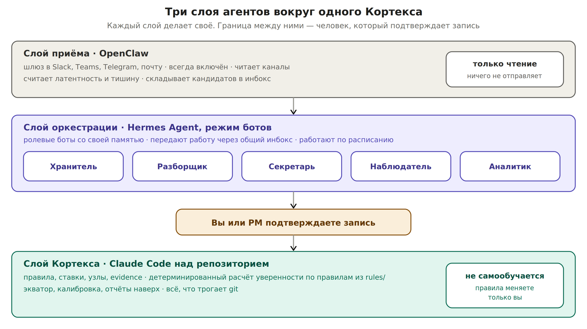

# П9. Команда агентов: Hermes, OpenClaw и Claude Code

До этого места в документе был один агент — Claude Code над репозиторием. Он работает, когда вы его запускаете. При пяти потоках этого перестаёт хватать: часть работы должна идти без вас — по расписанию, в мессенджерах, круглосуточно. Для этого есть агенты другого класса.

**Связь с методологией:** PAF прямо предусматривает этот момент. Когда доля агентов в работе растёт, дополнительным объектом управления инженера продукта становится портфель агентов ([раздел 6](../theory/roles.md)). Этот раздел — о том, как такой портфель выглядит у корпоративного PO.

## Три класса агентов и их роль

| **Агент** | **Что это** | **Сильная сторона** | **Где опасен** |
| --- | --- | --- | --- |
| Claude Code | Агент над файлами и git, запускается по команде | Детерминированность: одни и те же правила дают одинаковый результат. Работает с репозиторием напрямую | Не работает, пока вы его не запустили |
| Hermes Agent | Открытый (MIT) агент Nous Research с постоянной памятью, самосоздаваемыми навыками и выходом в мессенджеры. В режиме ботов — набор ролевых агентов со своей памятью, которые передают работу друг другу | Работает постоянно, помнит контекст между сессиями, учится на повторяющихся задачах | Самообучение: навыки меняются по опыту. Для правил, которые не должны дрейфовать, это минус |
| OpenClaw | Открытый (MIT) самостоятельно размещаемый ИИ-ассистент со шлюзом в мессенджеры — Slack, Teams, Telegram и другие. Ранее назывался Clawdbot и Moltbot | Видит поток там, где он реально идёт: в чатах и почте. Всегда включён | Может действовать от вашего имени. Известны публичные случаи потери контроля: в феврале 2026 агент массово удалил письма руководителя по alignment в Meta вопреки требованию действовать только после одобрения — инструкция потерялась при сжатии контекста |

*Приём, оркестрация и Кортекс — три слоя с человеком на границе*

## Главное правило архитектуры

Уверенность считает только детерминированный инструмент по правилам из `rules/` (в стартовом репозитории это утилита `cortex`, см. [приложение E](../appendix/commands.md)); Claude Code — агент, который его вызывает и показывает результат. Не Hermes и не OpenClaw. Ступень по артефакту выставляет человек или детерминированный агент, но никогда самообучающийся бот.

Причина принципиальная. Ценность числа уверенности — в том, что его нельзя подкрутить: одни и те же артефакты по одним и тем же правилам дают одно и то же число. Самообучающийся агент меняет свои навыки по опыту — и через месяц может начать считать иначе, чем вы договорились. Для рутинных задач это достоинство, для расчёта уверенности — дефект.

**Отсюда разделение:** самообучающиеся агенты собирают и готовят. Детерминированный агент считает. Человек подтверждает запись между ними.

## Что делегировать: карта задач

| **Задача** | **Агент** | **Уровень автономии** | **Ваша роль** |
| --- | --- | --- | --- |
| Сбор недельных артефактов техлидов из каналов | OpenClaw читает, Hermes собирает в инбокс | Сам, только чтение | Читаете сводку |
| Подсчёт латентности смежников и тишины по узлам | OpenClaw или Hermes-«Наблюдатель» | Сам | Реагируете на красное |
| Разбор инбокса в evidence и узлы | Claude Code | Предлагает запись | Подтверждаете |
| Ежедневный скан ставок | Claude Code по расписанию, доставка через Hermes в Telegram | Сам | Пять минут чтения |
| Классификация обращений внешнего клиента | Hermes-«Разборщик» | Предлагает тип | PM подтверждает |
| Подготовка к синку или 1:1: что известно по потоку и человеку | Hermes-«Секретарь» | Сам | Читаете перед встречей |
| Резюме встречи и письмо-фиксация смежнику | Hermes-«Секретарь» | Черновик | Правите и отправляете сами |
| Выгрузка истории задач для расчёта ёмкости | Hermes-«Аналитик» или Claude Code | Сам | Проверяете репрезентативность |
| Хранение и дожим подтверждений | Hermes-«Хранитель» вместе со стажёром | Напоминания себе и стажёру | Стажёр отправляет |
| Расчёт уверенности, экватор, калибровка | Только детерминированный инструмент и агент над ним (Claude Code) | Считает по правилам | Решаете по результату |
| Черновики требований и декомпозиции квартала | Claude Code со скиллами | Черновик | Правите смысл |

## Чего не делегировать никому

| **Решение** | **Почему** |
| --- | --- |
| Обещания наружу: даты, сроки, объём | Это ваша ответственность, и она не переносится на агента ни юридически, ни организационно |
| Изменение правил: лестница, пороги, сроки годности | Тот, кто меняет правила, может получить любое число. Правила меняете только вы и только на калибровке |
| Отправка сообщений от вашего имени во внешние каналы | Одно неудачное письмо смежнику или клиенту стоит больше, чем вся сэкономленная неделя |
| Разговоры про даты, эскалации, переговоры о ёмкости | Здесь решает доверие между людьми, а не информация |
| Запись в узлы знания без подтверждения | Иначе поток сам себя превратит в факты |

## Ролевые боты под вашу конфигурацию

Режим ботов в Hermes позволяет держать несколько специализированных агентов — у каждого своя роль, память и модель. Для пяти потоков разумный набор — пять ботов.

| **Бот** | **Что делает** | **Куда пишет** |
| --- | --- | --- |
| Хранитель | Собирает ссылки, письма, прогоны; следит, какие подтверждения ожидаются и от кого | `inbox.md` |
| Разборщик | Классифицирует обращения внешнего клиента по четырём типам и ищет похожие прошлые | Очередь клиента, на подтверждение PM |
| Секретарь | Готовит контекст к встречам, пишет черновики резюме и писем-фиксаций | Черновики вам |
| Наблюдатель | Считает время ответа смежников и находит узлы, по которым тишина | `log/`, красные строки |
| Аналитик | Делает выгрузки из Jira: доля поддержки, история переносов, точность оценок | Файлы для расчёта |

**Жёсткое ограничение для всех пяти:** ни один бот не пишет в `nexus/`, `bets/` и `rules/`. Их выход — инбокс, черновики и `log/`. Всё, что меняет знание и уверенность, проходит через Claude Code и ваше подтверждение.

## Когда какой агент подключается

| **Уровень зрелости** | **Агенты** | **Почему именно так** |
| --- | --- | --- |
| 0–1, первый квартал | Только Claude Code | Сначала должны устояться правила и привычка. Агенты поверх неустоявшейся системы автоматизируют хаос |
| 2, второй квартал | Плюс Hermes: расписание и два-три бота | Ежедневный скан начинает приходить сам, подготовка к встречам снимается с вас |
| 3, масштаб | Плюс шлюз приёма потока (например, OpenClaw в режиме чтения) | Только когда есть согласование безопасности и понятно, что агент читает, а не пишет |

## Корпоративная безопасность

Оба агента — самостоятельно размещаемые, данные остаются на вашей инфраструктуре. Это необходимое условие, но не достаточное.

| **Вопрос** | **Что сделать до подключения** |
| --- | --- |
| Доступ к корпоративному мессенджеру и почте | Согласовать с безопасностью. Подключение агента к рабочему Slack без согласования — нарушение, даже если данные никуда не уходят |
| Какая модель обрабатывает данные | Проверить, куда уходят запросы. Самостоятельное размещение агента не означает самостоятельного размещения модели |
| Права агента | Начинать только с чтения. Право отправки — отдельное решение, по одному каналу, после месяца работы на чтении |
| Кому разрешено писать агенту | Ограничить список отправителей. Агент, доступный всем, выполняет чужие инструкции |

## Сколько работы реально уходит агентам

| **Тип работы PO** | **Может взять агент** | **Остаётся вам** |
| --- | --- | --- |
| Сбор информации: статусы, артефакты, выгрузки | Почти полностью | Проверка, что источник корректен |
| Подготовка: контекст к встречам, черновики, отчёты | Большую часть | Правка смысла и отправка |
| Наблюдение: латентность, тишина, протухшее знание | Полностью | Реакция на сигнал |
| Расчёт: уверенность, достижимость, ёмкость | Полностью, но только детерминированный агент | Решение по результату |
| Решения: обещания, приоритеты, правила | Ничего | Всё |
| Отношения: даты, эскалации, переговоры | Ничего | Всё |

**Итог:** агенты забирают сбор, подготовку, наблюдение и расчёт — ту часть недели, которая растёт вместе с числом потоков. Решения и отношения остаются вам — ту часть, за которую платят на уровне Lead. Именно поэтому рост обязательств втрое при той же команде становится выполнимым.

Дальше — механика по шагам. Она описывает отдельные операции: как собрать репозиторий, как считать достижимость, как разговаривать со смежниками. Playbook отвечает на вопрос «что менять», шаги — на вопрос «как это делается технически».
