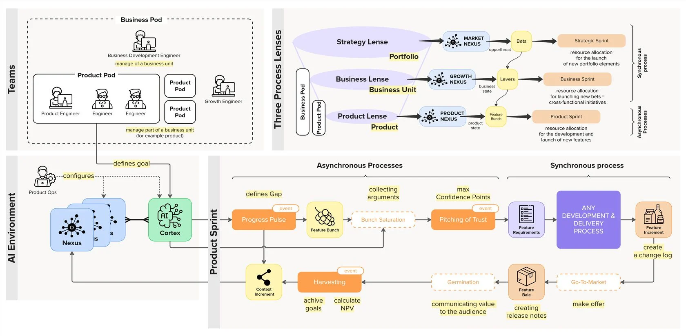

# 5. Архитектура PAF Product Ops: разбор общей схемы

*Общая схема операционной модели PAF. Источник: productframework.ru/ops/main, CC BY-SA 4.0*

Схема состоит из четырёх квадрантов. Разберём каждый.

| **Квадрант** | **Что на нём** | **Что это значит** |
| --- | --- | --- |
| Teams (команды) | Business Pod с инженером по развитию бизнеса, внутри — Product Pod'ы с инженером продукта и инженерами, рядом инженер роста | Команда бизнес-юнита управляет всем юнитом, команда продукта — его частью. Требование PAF: у команды есть все ресурсы, чтобы создавать, дистрибутировать и монетизировать ценность |
| Three Process Lenses (три линзы) | Стратегия → нексус рынка → Bets → стратегический спринт; бизнес → нексус роста → Levers → бизнес-спринт; продукт → нексус продукта → Feature Bunch → продуктовый спринт | Каждая линза = свой объект управления, свой нексус, своя единица изменений и свой спринт. Стратегический и бизнес-уровень синхронны, продуктовый — асинхронен |
| AI Environment (среда ИИ) | Нексусы, Кортекс, Product Ops настраивает, инженер продукта определяет цель | Инженер продукта не правит знание руками: он ставит задачу Кортексу, тот работает с Нексусами. Product Ops отвечает за настройку самой этой машины |
| Product Sprint (продуктовый спринт) | Progress Pulse → Feature Bunch → Bunch Saturation → Pitching of Trust → требования → разработка → инкремент → Go-To-Market → Bale → Germination → Harvesting → инкремент контекста | Левая часть асинхронна (скорость определяется агентом и инженером), правая синхронна (упирается в разработку и рынок). Цикл замыкается: знание возвращается в Нексус |

| **Элемент цикла** | **Что происходит** |
| --- | --- |
| Progress Pulse (событие) | Команда смотрит на приборную панель продукта и определяет гэп между текущим и целевым состоянием |
| Feature Bunch | Набор фич, закрывающий гэп. Определяется только текущим состоянием продукта, а не историей запросов |
| Bunch Saturation | Насыщение банча аргументами: инженер продукта ищет то, что повышает уверенность |
| Pitching of Trust (событие) | Инженер продукта питчит банч команде, команда пытается завалить аргументы, назначается Confidence Point. Фичи с низкой оценкой выкидываются |
| Feature Requirements → разработка | По выжившим фичам формируются требования и передаются в разработку по принятым в команде процессам |
| Feature Increment + Change Log | Результат разработки: инкремент продукта, для которого инженер продукта ведёт журнал изменений |
| Go-To-Market → Bale (бейл, тюк фичи) | Маркетинг делает оффер и упаковывает инкремент в бейл: инкремент плюс понятный оффер и план дистрибуции, плюс release notes |
| Germination (проращивание) | Аудитория онбордится в фичу, определяет для себя ценность, формирует привычку |
| Harvesting (событие) | Команда подводит итог запуска: какой импакт в цели, фиксируется NPV |
| инкремент контекста | Новые знания превращаются в прирост контекста и сохраняются в Нексусах |

**Адаптация под корпоративного PO:** в платформенной или интеграционной команде маркетингового блока (Go-To-Market, бейл) может не быть — потребитель внутренний. Тогда бейл превращается в уведомление команды-потребителя и документацию контракта, а проращивание — в их подключение к вашей возможности. Остальной цикл работает без изменений.
