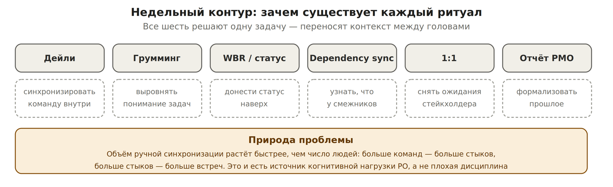
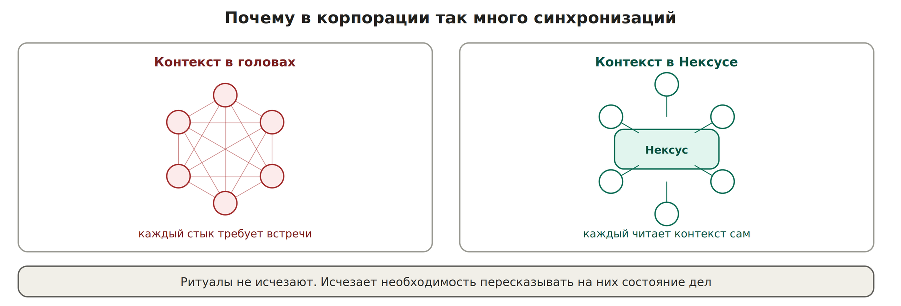
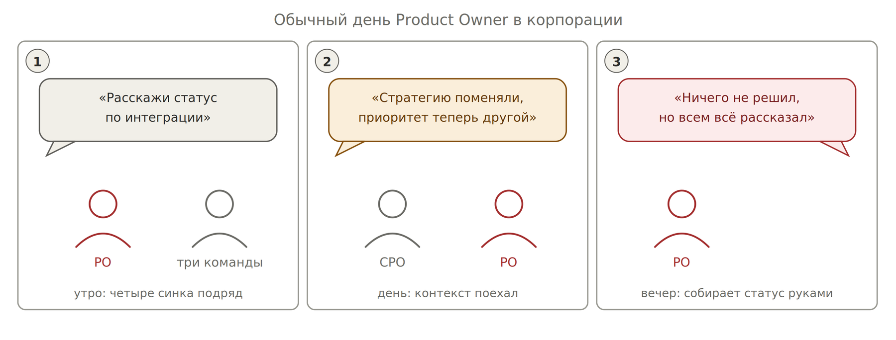

# 2. Откуда берётся когнитивная нагрузка

*Недельный контур: шесть ритуалов, одна функция*

*Число стыков растёт быстрее числа людей*

Дали две команды вместо одной — встреч стало не в два раза больше, а в три. Стратегия поменялась в середине квартала — весь перенесённый контекст надо переносить заново. Ушёл человек — унёс часть контекста с собой.

*Типичный день: контекст переносится голосом, решения не принимаются*

## Это реальная проблема или преувеличение

Проблема измерена. Ниже данные исследований, а не ощущения.

| **Что измеряли** | **Результат** | **Источник** |
| --- | --- | --- |
| Возврат к прерванной работе | В среднем 23 минуты 15 секунд до возобновления прерванной работы в тот же день, обычно после двух промежуточных дел | Gloria Mark, UC Irvine (Gallup Business Journal, 2006) |
| Переключение между рабочими инструментами | 43% удалённых работников США и Великобритании считают, что тратят слишком много времени на переключение между программами | Qatalog и Ellis Idea Lab (Cornell), 2021. Часто цитируемые «9,5 минут на возврат в поток» встречаются только в пересказах, первоисточник недоступен |
| Объём коммуникации у офисного сотрудника | В среднем 117 писем и 153 сообщения Teams в день; в среднем раз в две минуты в 8-часовом рабочем дне — собрание, письмо или уведомление | Microsoft Work Trend Index 2025 |
| Характер календаря | Половина встреч приходится на окна 9–11 и 13–15 утра и дня, то есть на пики концентрации; 57% встреч — спонтанные звонки без приглашения в календаре | Microsoft Work Trend Index 2025 |
| Субъективная оценка работы | 48% сотрудников и 52% руководителей говорят, что их работа хаотична и раздроблена | Microsoft Work Trend Index 2025 (опрос 31 000 работников знаний) |
| Цена переключения между задачами | По словам психолога Дэвида Мейера (цитата на странице APA), даже короткие «умственные блоки» при переключении могут стоить до 40% продуктивного времени; цена одного переключения мала, но накапливается | American Psychological Association, Multitasking: switching costs |
| Эффект от доступа к ИИ | Восьмимесячная этнография в одной американской технологической компании (около 200 человек): ИИ не сократил работу, а усилил интенсивность — люди работали быстрее, брали больше задач и дольше; нагрузка стала когнитивно плотнее. Исследование качественное, на одной компании, не рецензировано | Ranganathan и Ye, Berkeley Haas, HBR, февраль 2026 |

**Что из этого следует:** выгорание PO — не следствие слабой дисциплины. Это структурный эффект: нагрузка растёт от числа стыков, а не от объёма задач. Последняя строка таблицы особенно важна — ИИ сам по себе проблему не решает и может её усилить, если не менять способ хранения контекста.

Это и есть механизм выгорания PO: нагрузка растёт от структуры, а не от объёма работы. Дисциплина тут не помогает — помогает только вынос контекста из голов в систему.
