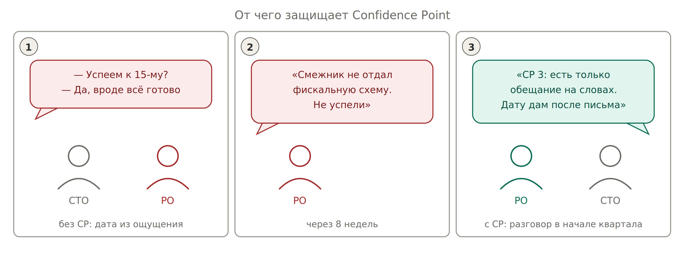
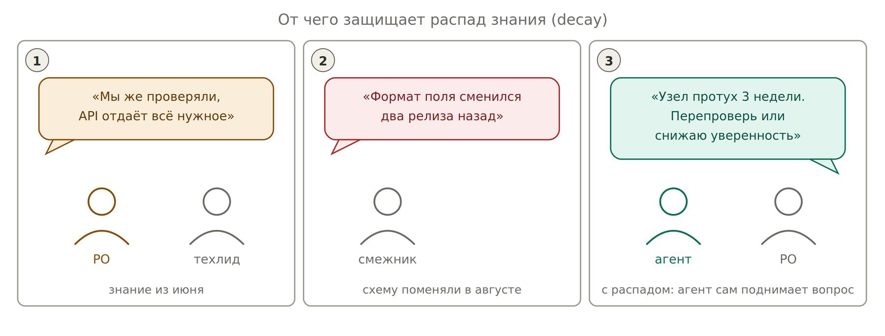

# 9. Откуда берётся число Confidence Point

*От чего защищает эта метрика: от даты, названной по ощущению*

CP не считается формулой. Он считывается с лестницы по одному вопросу: какой самый сильный артефакт существует и открывается по ссылке? Нет ссылки — нет ступени.

## Ограничители и потолки

Ступени (от 2 «кто-то сказал» до 9 «работает в проде постоянно») описаны в [приложении A](../appendix/ladder.md). Поверх них действуют ограничители: уверенность не поднимается выше потолка, каким бы убедительным ни был текст.

| **Ограничитель** | **Правило** |
| --- | --- |
| Scope | «Сверка сошлась на 50 транзакциях» — факт про 50, не про 50 000. Объём подтверждения обязателен |
| Authority | Повышать CP по объекту может только его владелец. Пересказ — слухи, потолок 2 |
| Channel | Устное и личка — потолок ступени 3. Email, тикет, MR, прогон CI — без потолка |
| Редкое наблюдение | Видите команду раз в спринт — потолок около 5 |
| Спор | Пока два источника расходятся, уверенность не выше 4: расхождение и есть неопределённость |

Как это исполняется в инструменте — что проверяет код, а что дисциплина — см. [приложение A](../appendix/ladder.md#code).

## Как читать динамику

| **Наблюдение** | **Что значит** |
| --- | --- |
| CP упал | Хорошо. Риск был и раньше — система его заметила |
| CP стоит 4 недели | Плохо. Никто не добывает доказательство |
| Темп +1 за 2 недели, нужно +5 за 6 недель | Не дотянет. Видно за 6 недель до провала |

**Правило слабого звена:** CP ставки равен минимуму CP её критических зависимостей. Цель не прочнее слабейшей ставки.

## Откуда берётся `change_rate`

1. Измерить: история коммитов схемы, релизноуты, журнал инцидентов. Двадцать минут.
2. Спросить владельца: как часто это менялось за полгода?
3. Данных нет — ставить `high`.

Асимметрия ошибки: завысили — заплатили перепроверкой; занизили — получили протухшее знание и сорванный квартал. Сроки годности и формула распада — в [приложении C](../appendix/decay.md).

*От чего защищает распад: от уверенности на устаревшей проверке*
