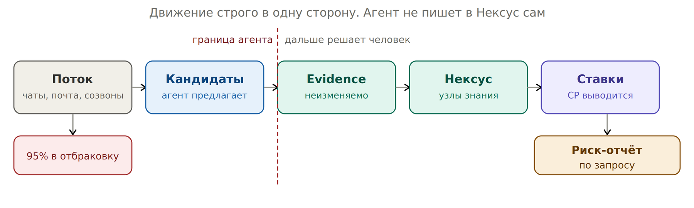

# 14. Данные: git как носитель истины


*Поток → кандидаты → evidence → Нексус → ставки. Обратного движения нет*

```text
rules/      ladder.md · gates.md · decay.md   решения, без CP
evidence/   неизменяемые артефакты, только добавление
nexus/      узлы знания, собранные из evidence
bets/       ставки: порог, дата, зависимости, CP
log/        наблюдения без артефакта
decisions/  решения и калибровки
```

!!! info "Эти слои в стартовом репозитории"
    Здесь слои названы концептуально. В [`poh-cortex`](https://github.com/po-helper-org/poh-cortex) они лежат в `GROUND/`: правила — YAML в `GROUND/SCHEMA/`, ставки, артефакты, решения и наблюдения — в `GROUND/DECIDE/`, узлы — в `GROUND/NEXUS/<нексус>/`, очередь — в `GROUND/_intake/`. Таблица соответствия — в [приложении D](../appendix/files.md#where).

**Принцип «git для знания, база — для исполнения».** Истину о знании (узлы, ставки, правила, решения) держат файлы под git. Состояние исполнения (запуски агентов, очереди, статусы) живёт в базе, а связи между ними вычисляются, а не копируются ([обещания](../practice/promises.md)). Правило деплоя: прод — это слитый коммит.

| **Элемент модели** | **Git-примитив** |
| --- | --- |
| Провенанс | Автор, дата, подпись коммита |
| Дата проверки узла | `git log -1 --format=%cd nexus/x.md` |
| История CP | `git log -p bets/x.md` |
| Полномочия владельца | `CODEOWNERS` (уровень 2) |
| Гейт | Required status check блокирует merge (уровень 2) |
| Риск-отчёт | Генерируется, не хранится |

**Что покупают git-механизмы:** защиту от подделки задним числом. Она нужна, когда в репозиторий пишут несколько человек. В одиночном репозитории — не нужна.
