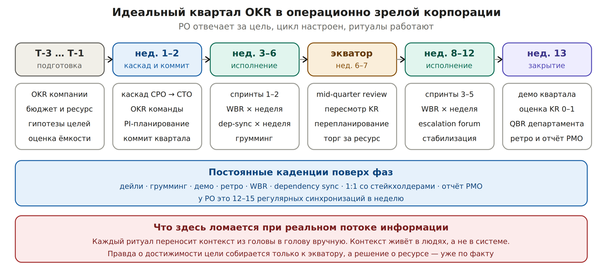

# 1. Идеальный квартал OKR: как это устроено на самом деле

Речь не про хаос. Возьмём операционно зрелую корпорацию: цикл настроен, каденции соблюдаются, PO реально отвечает за цель, а не собирает тикеты.

*Квартальный контур OKR: фазы, гейты, постоянные каденции*

## Что делает PO на каждой фазе

| **Фаза** | **Ритуалы** | **Действия PO** | **Чем платит** |
| --- | --- | --- | --- |
| T-3 … T-1 | стратегическая сессия, планирование ёмкости | Гипотезы целей, оценка достижимости, торг за ресурс | Оценки строятся на прошлом квартале и интуиции |
| нед. 1–2 | каскад OKR, PI-планирование, планирование спринта | Декомпозиция KR, согласование зависимостей, коммит квартала | Коммит даётся до того, как хоть что-то проверено |
| нед. 3–6 | дейли, грумминг, демо, ретро, WBR, dependency sync, 1:1 | Сбор статусов, разбор блокеров, поддержание Jira и гантта | Основное время уходит на перенос информации |
| экватор | mid-quarter review | Пересмотр KR, перепланирование, торг за ресурс | Картина собирается вручную и уже частично устарела |
| нед. 8–12 | те же каденции плюс escalation forum | Удержание темпа, эскалации, управление ожиданиями | Эскалация идёт по факту срыва, не по прогнозу |
| нед. 13 | демо квартала, оценка KR, QBR, ретро | Оценка 0–1, объяснение отклонений, отчёт PMO | Объяснение вместо управления |

Процесс не сломан. Сломана экономика внимания внутри него: каждый ритуал существует, чтобы вручную перенести контекст между людьми.
