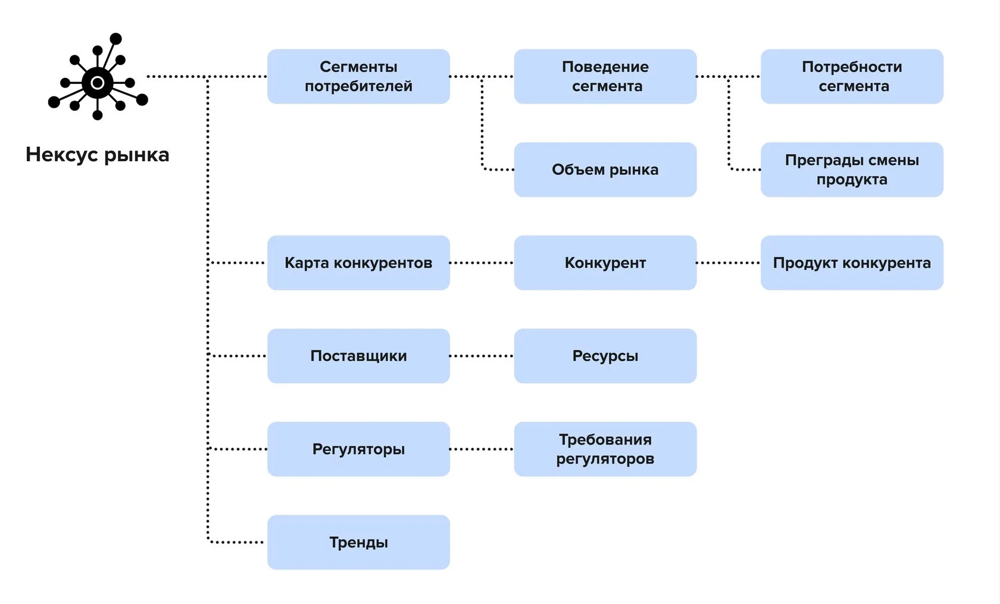
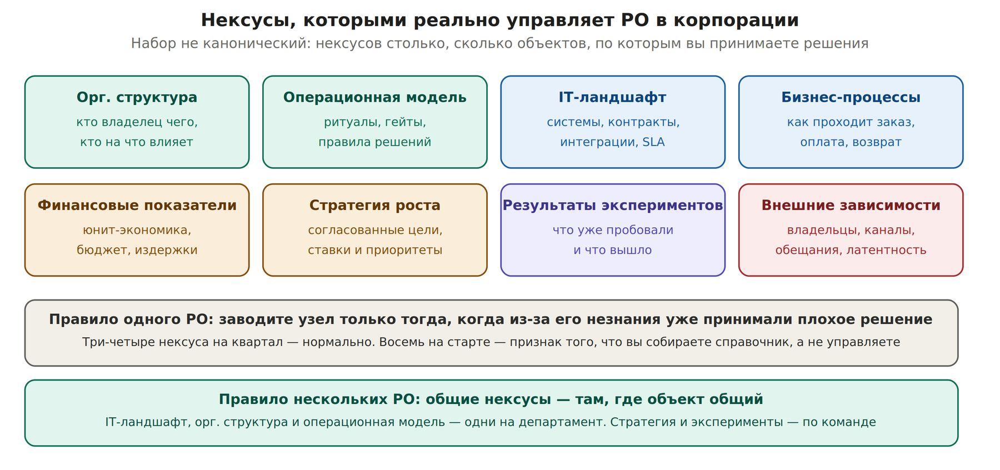

# 7. Нексусы: как устроен контекст

Нексус — живая модель объекта управления, динамический PRD на весь жизненный цикл, цифровой двойник продукта. Состоит из узлов: самостоятельных кусочков контекста. Одни узлы полные и свежие, другие нет.

| **Тип нексуса** | **Объект управления** | **Цель контекста** |
| --- | --- | --- |
| Нексус рынка | Рынок | Поиск возможностей и угроз для сокращения рисков достижения миссии |
| Нексус продукта | Продукт | Максимизация монетизируемой ценности и сокращение time-to-market |
| Нексус роста | Система роста | Максимизация чистой прибыли от новых и текущих клиентов, сокращение time-to-profit |
| Нексус компании | Портфель бизнес-юнитов | Максимизация инкремента миссии за минимальный ресурс при заданном риске |
| Нексус операционной модели | Процессы управления | Правила, границы делегирования, протокол работы с памятью |

*Структура нексуса рынка: узлы и связи между ними. Источник: productframework.ru/ops/main, CC BY-SA 4.0*

Узлы связаны: сегменты потребителей → поведение сегмента → потребности сегмента и преграды смены продукта; карта конкурентов → конкурент → продукт конкурента; отдельно поставщики с ресурсами, регуляторы с требованиями, тренды.

## Спелость контекста

Метрика качества Нексуса, которую инженер продукта обязан повышать. Комбинирует два свойства:

- Полнота — какая часть заданной структуры узлов заполнена.
- Актуальность — как давно информация актуализировалась.

Отсюда два этапа жизни узла: созревание, когда объём информации растёт, и увядание, когда информация теряет актуальность. Именно увядание в нашей адаптации считается формулой распада и автоматически снижает CP ставок, стоящих на протухшем узле.

**Что меняется для платформенной команды:** таксономия узлов другая. Вместо сегментов и конкурентов — контракты интеграций, SLA смежных систем, фискальные и юридические основания, владельцы внешних подов. Механика спелости при этом не меняется.

## Нексусы, которыми реально управляет PO в корпорации

Пять типов из методологии — канон для продуктовой компании. У корпоративного PO объекты решений другие, и набор нексусов надо собирать под них. Нексус — это не обязательная форма, а гибкая инструкция: их может быть сколько угодно, и каждый существует ровно до тех пор, пока помогает принимать решения.

*Восемь объектов, по которым PO в корпорации принимает решения*

| **Нексус** | **Что внутри** | **Какое решение он спасает** |
| --- | --- | --- |
| Орг. структура | Кто владелец какой системы, кто на что влияет, кто кому подчиняется | Кому писать, чтобы вопрос сдвинулся, и чьё слово повышает уверенность |
| Операционная модель | Ритуалы, гейты, чьё согласие нужно, как принимаются решения | Когда и как ставить вопрос, чтобы он был решён, а не отложен |
| IT-ландшафт | Системы, контракты, интеграции, SLA, версии схем | Можно ли обещать срок по интеграции |
| Бизнес-процессы | Как реально проходит заказ, оплата, возврат, поддержка | Не забыть постпродажу и расчёты, из-за которых валится квартал |
| Финансовые показатели | Юнит-экономика, бюджет, издержки, что считается эффектом | Чем обосновать приоритет и что показывать как результат |
| Стратегия роста | Согласованные цели, ставки, приоритеты и их история изменений | Что делать, когда стратегию поменяли в середине квартала |
| Результаты экспериментов | Что уже пробовали, что вышло, где лестница врала | Не проверять второй раз то, что уже проверяли |
| Внешние зависимости | Владельцы, каналы, обещания, латентность ответа | Давать или не давать дату по чужой зоне |

## Принципы формирования: когда вы один и когда вас много

| **Ситуация** | **Принцип** |
| --- | --- |
| Вы один PO, первый квартал | Узел заводится только тогда, когда из-за его незнания вы уже приняли плохое решение. Три-четыре нексуса — нормально. Восемь на старте означают, что вы собираете справочник вместо управления |
| Вы один, но ведёте несколько команд | Нексусы привязаны к объекту, а не к команде. Две команды на одной платформе — один нексус IT-ландшафта. Плюс обязательный портфельный: зависимости между командами |
| Вас становится несколько | Общие нексусы там, где объект общий: IT-ландшафт, орг. структура, операционная модель — одни на департамент. Стратегия и результаты экспериментов — по команде |
| Департамент целиком | У каждого узла появляется владелец, который единственный имеет право его повышать. Технически это `CODEOWNERS`, организационно — договорённость, кто отвечает за какое знание |

**Признак, что нексусов слишком много:** вы не помните, когда последний раз открывали половину из них. Нексус, в который никто не смотрит и который никто не обновляет, работает хуже отсутствующего: он создаёт ложное чувство, что знание есть.
