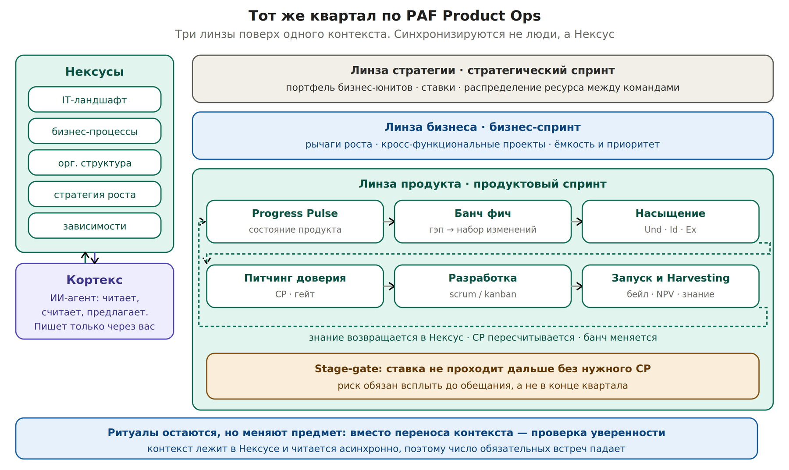
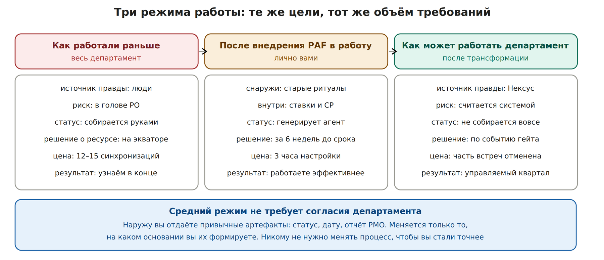
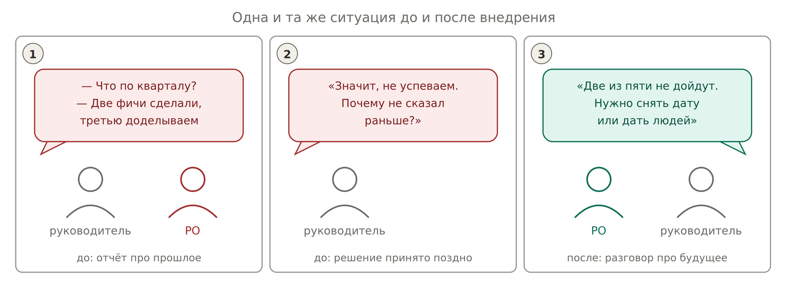

# 3. Тот же квартал по PAF Product Ops

## 3. Тот же квартал по PAF Product Ops

Те же цели. Тот же объём требований. Те же корпоративные ритуалы — они не отменяются. Меняется, где живёт контекст и что проверяется на встречах.

*Три линзы поверх Нексусов и Кортекса. Продуктовый цикл внутри*

### Что означают термины на схеме

| **Термин на схеме** | **Человеческими словами** |
| --- | --- |
| Нексус | Папка с файлами, где лежит знание об одном объекте: про IT-ландшафт, про зависимости, про процессы. С указанием, кто сказал и когда проверяли |
| Кортекс | Ваш ИИ-агент плюс правила, по которым он работает с этими файлами |
| Линза | Уровень разговора: департамент и портфель, бизнес-юнит, конкретный продукт. На каждом свой объект и свой ритм |
| Банч фич | Набор изменений, который команда берёт в спринт, чтобы закрыть разрыв между тем, что есть, и тем, что нужно. Не беклог: собирается из сегодняшнего состояния, а не из старых запросов |
| Progress Pulse | Точка, где вы смотрите на состояние дел и формулируете, чего не хватает для цели |
| Питчинг доверия | Разговор в конце спринта: под что команда готова подписаться, а под что нет |
| Гейт | Правило, при каком уровне подтверждённости и к какой дате вы даёте обещание за пределы команды |
| Harvesting | Разбор итогов: что сработало, что нет, и какие правила после этого надо поправить |

### Пошагово внутри квартала

| **Шаг** | **Что происходит** | **Где в корпоративном календаре** |
| --- | --- | --- |
| Карта целей | Цель квартала раскладывается на ставки с порогом и датой | Вместо декомпозиции KR в задачи — нед. 1–2 |
| Progress Pulse | Скан Нексуса: текущее состояние против целевого, гэп в знании | Планирование спринта |
| Банч | Набор изменений, который закрывает гэп. Не беклог, а срез на сегодня | Вместо грумминга бесконечного беклога |
| Насыщение | Understand → Identify → Execute: добыть артефакт, а не построить план Б | Внутри спринта, как обычные задачи |
| Питчинг доверия | Команда атакует аргументы, CP назначается по выжившему доказательству | Конец спринта, рядом с демо |
| Stage-gate | Ставка не идёт дальше без нужного CP. Три исхода: убить, донасытить, дать дату | Момент, когда вы даёте обещание наружу |
| Разработка | Любой scrum или kanban. PAF в это не вмешивается | Как сейчас |
| Запуск и Harvesting | Фиксация эффекта, знание возвращается в Нексус, лестница калибруется | Демо квартала, QBR, ретро |

**Ключевое отличие:** ритуалы сохраняются, но перестают быть механизмом переноса контекста. На встрече не пересказывают состояние дел — его читают заранее. Встреча нужна, чтобы проверить уверенность и принять решение.

## 3.1. Три режима: как жили, как живёте вы, как может жить департамент

*Один и тот же квартал в трёх режимах*

| **Аспект** | **Как работали раньше** | **После внедрения PAF в работу** | **Как может работать департамент** |
| --- | --- | --- | --- |
| Что снаружи | Ритуалы, статусы, Jira, отчёты PMO | То же самое, без изменений | Часть встреч отменена: контекст читается из Нексуса |
| Что внутри | Контекст в голове PO и в переписке | Ставки, CP, evidence в вашем репозитории | Общий Нексус на департамент, `CODEOWNERS` по владельцам |
| Статус для PMO | Собираете руками несколько часов в неделю | Генерирует агент из ставок по полю jira | Не собирается: PMO смотрит дашборд достижимости |
| Оценка риска | Вероятность × влияние на глаз | CP по вашей лестнице, откалиброванной под ваш домен | Единая лестница департамента, сравнимая между командами |
| Момент решения | Экватор или конец квартала | За 6 недель до срока, по арифметике траектории | По событию гейта, автоматически |
| Эскалация | Жалоба на смежников | Запрос об отсутствующем артефакте | Заблокированный гейт как публичный факт |
| Кого надо уговорить | — | Никого. Ни один процесс не меняется | CTO, CPO, PMO, руководителей команд |
| Цена входа | — | 3 часа настройки, 5 минут в день | Квартал на трансформацию, обучение, инфраструктура |
| Что получаете | — | Работаете эффективнее при том же процессе вокруг | Операционная эффективность департамента |

*Тот же руководитель, тот же квартал. Разный момент разговора*

Наружу уходят привычные артефакты: статус, дата, отчёт. Меняется только основание, на котором вы их формируете. Поэтому переход возможен в одиночку: сначала вы, потом коллега, потом департамент, если результат заметят.

**Порядок, который не работает:** начать с трансформации департамента. Единая лестница, общий Нексус и дашборды имеют смысл только после того, как хотя бы один PO прожил с этим квартал и откалибровал правила на реальных данных.
