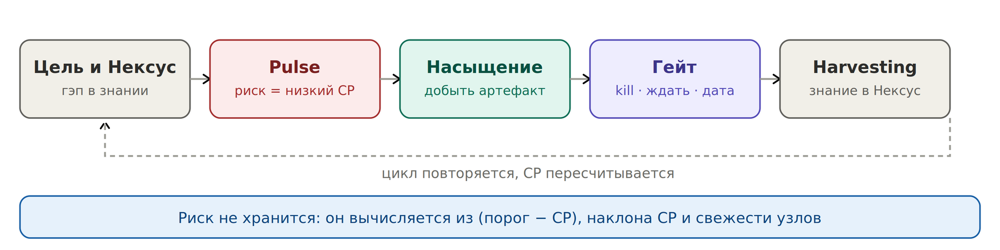

# 12. Жизненный цикл риска

*Риск рождается на Pulse как низкий CP и умирает на гейте или в Harvesting*

| **Этап** | **Что происходит** |
| --- | --- |
| Pulse | Скан Нексуса. Гэп между целью и знанием превращается в низкий CP |
| Насыщение | Understand → Identify → Execute. Добыть артефакт, а не построить план Б |
| Гейт | Три исхода: убить ставку, донасытить, дать дату наружу |
| Исполнение | Новая информация снижает CP по событию, а не по расписанию |
| Harvesting | Знание в Нексус, калибровка лестницы |
