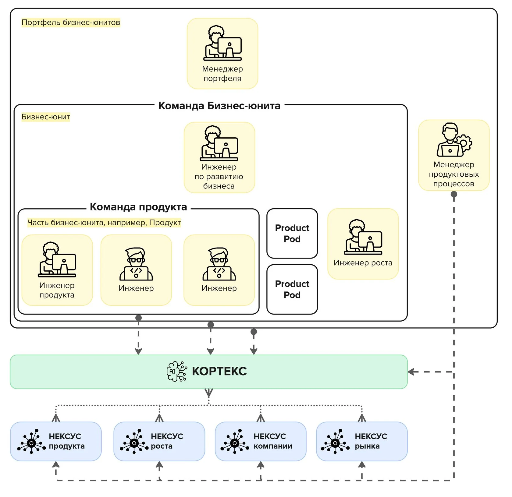
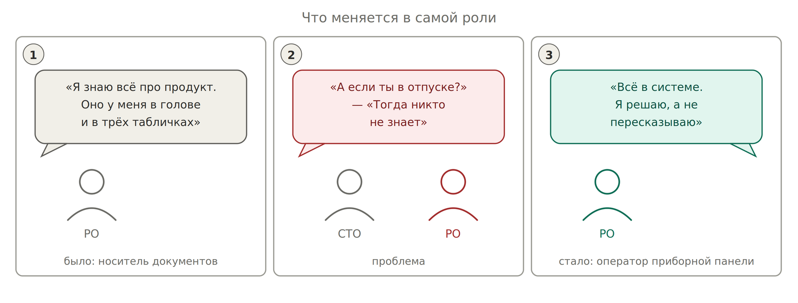

# 6. Ролевая модель и адаптация к классической IT-структуре

*Ролевая модель PAF: команды, Кортекс, Нексусы. Источник: productframework.ru/ops/main, CC BY-SA 4.0*

PAF определяет пять ролей. Обязательна только одна — инженер продукта. Команда может состоять даже из одного человека, если способна самостоятельно реализовать жизненный цикл своего объекта управления.

| **Роль PAF** | **Объект управления** | **Функция** | **Кем является в классической структуре** |
| --- | --- | --- | --- |
| Инженер продукта (Product Engineer) | Продукт | Максимизация монетизируемой ценности за счёт определения правильных свойств продукта | Product Owner, Product Manager |
| Инженер по развитию бизнеса | Бизнес-юнит | Максимизация NPV юнита; работает в связке с инженером роста, управляет инженерами продукта | Head of Product, руководитель направления, владелец P&L |
| Менеджер портфеля | Портфель бизнес-юнитов | Максимизация NPV портфеля, баланс маржинальности, разрешение каннибализации, распределение ресурса между командами | CPO, руководитель группы продуктов |
| Инженер роста (Growth Engineer) | Модель роста | Максимизация mNSM за счёт привлечения новых клиентов и роста LTV | Growth PM, продуктовый маркетолог |
| Менеджер продуктовых процессов (Product Ops) | Product operations | Настройка и эффективность Нексусов и Кортекса, повышение качества процессов управления | Аналог скрам-мастера для PAF. В большинстве корпораций роли нет — функцию берёт на себя энтузиаст |

## Что делать, если роли в вашей структуре нет

| **Ситуация** | **Как адаптироваться** |
| --- | --- |
| Нет Product Ops | На уровне 0 эту функцию выполняете вы сами: правила в `rules/`, структура репозитория, настройка команд агента. Это и есть ваш Кортекс |
| Нет инженера роста, продукт не монетизируется напрямую | mNSM заменяется на метрику потребителя вашей возможности: adoption, time-to-integrate, объём продаж витрины |
| Вы формально PO, фактически ведёте несколько команд | Вы уже менеджер портфеля. Значит ваш обязательный объект — портфельный Нексус с зависимостями между командами, а не Нексусы отдельных продуктов |
| Роль PO размыта между PM, PO, BA и техлидом | PAF определяет роль через функцию, а не название. Инженер продукта — тот, кто отвечает за выбор свойств и несёт ответственность за результат. Если это вы — вы инженер продукта, как бы вас ни называли |
| Команда не обладает всеми ресурсами (требование PAF) | Это типичная корпоративная ситуация. Тогда объект вашего управления сужается до того, чем вы реально распоряжаетесь, а остальное фиксируется как внешняя зависимость с владельцем и потолком CP |

**Про трансформацию роли:** PAF исходит из того, что менеджер продукта превращается в инженера продукта: он проектирует не документы, а цифровой профиль продукта, и определяет AI workflow — какие задачи делегируются агенту полностью, а какие остаются человеку. Если доля агентов в работе растёт, дополнительным объектом управления становится портфель агентов.

*Суть перехода: знание переезжает из головы в систему*
