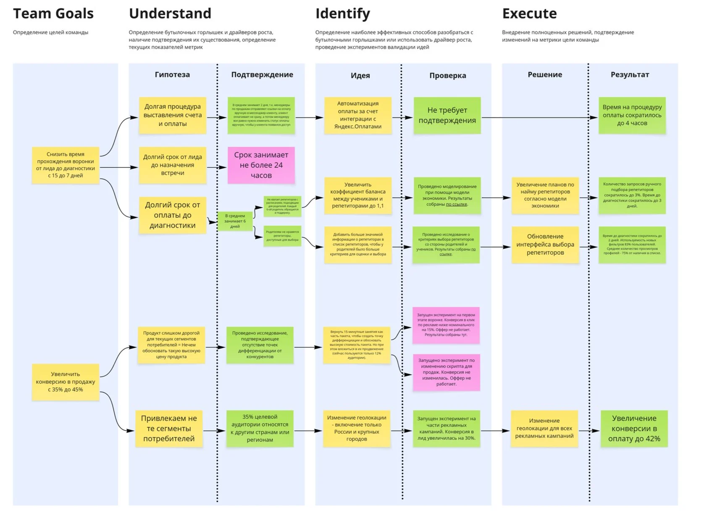

# 11. Насыщение банча: метод Und-Id-Ex

Насыщение банча строится на последовательности Understand → Identify → Execute. Цикл начинается с определения цели развития продукта и повторяется.

| **Этап** | **Что делает инженер продукта** |
| --- | --- |
| Цель | Определяется цель развития продукта |
| Understand | Анализирует Нексус: что сейчас влияет на выполнимость цели, какие свойства нужно создать или изменить. При необходимости формулирует гипотезы и проводит исследования |
| Identify | С помощью Кортекса формирует идеи, как расшить найденные бутылочные горлышки, и тестирует гипотезы. По мере получения информации меняется оценка уверенности, Нексус наполняется |
| Execute | Команда масштабирует подтверждённые решения на всю аудиторию и проверяет достижимость цели |

| **Принцип входа** | **Когда применяется** | **Что меняется** |
| --- | --- | --- |
| null base | Нет фундамента из данных: новый продукт или фича, сильно отличающаяся от текущих | Discovery с нуля: последовательно проверяются гипотезы потребности, ценностного предложения и реализации |
| data base | Продукт уже есть, из него можно извлечь поведение пользователей | Знание о бутылочных горлышках извлекается из данных, часть гипотез проверять не нужно |

*Доска Und-Id-Ex: от целей команды к результату. Источник: productframework.ru, CC BY-SA 4.0*

На доске видно устройство метода: цель команды раскладывается на гипотезы узких мест, у каждой гипотезы своё подтверждение, дальше идеи, проверки, решения и измеренный результат. Цвет показывает состояние: подтверждено, требует проверки, опровергнуто.

## Как это ложится на управление рисками квартала

| **Элемент доски** | **Чем становится у вас** |
| --- | --- |
| Цель команды | Квартальная цель, разложенная на ставки |
| Гипотеза узкого места | Зависимость ставки: что должно быть правдой |
| Подтверждение | Артефакт в `/evidence/` с автором, каналом и scope |
| Идея и проверка | Действие по насыщению: spike, тест против реального API, письмо владельцу |
| Решение | Прохождение гейта: дать дату, донасытить или убить ставку |
| Результат | Harvesting: сравнение заявленного CP с фактическим исходом и калибровка |

**Практический вывод:** доска Und-Id-Ex и реестр ставок — один объект в двух проекциях. Если удобнее думать визуально, ведите доску, а CP считайте по её колонке «подтверждение»: пустая ячейка означает ступень не выше 3.
